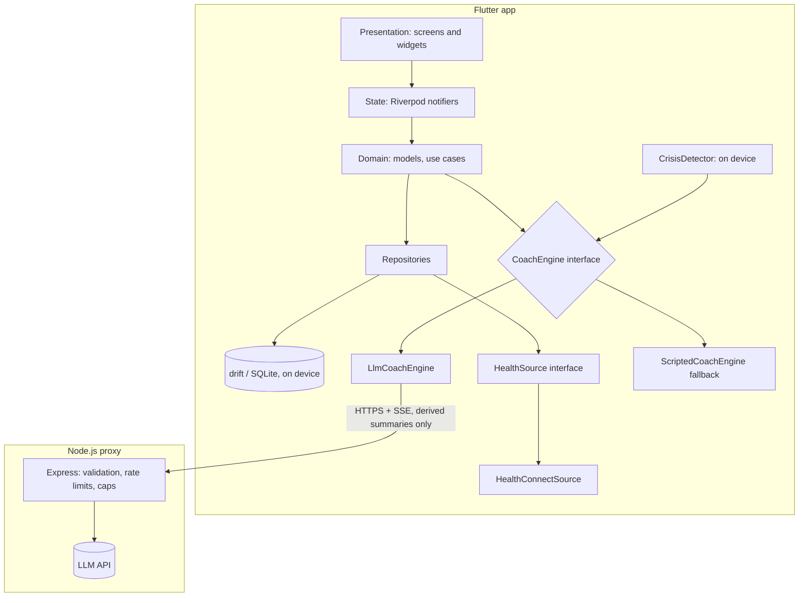

<div align="center">

# CuraTrail Android Prototype

**A native-feeling Android prototype of a CBT-inspired wellness coach: Health Connect readiness, an AI coach with a safety layer, and guided exercises.**

[Demo video](#) · [Download APK](#) · [Design doc](docs/DESIGN.md)

`Flutter` · `Material 3` · `Health Connect` · `Riverpod` · `drift` · `Node.js / TypeScript`

</div>

> **Independent concept prototype.** This project is not affiliated with, endorsed by, or built from the code of CuraTrail or Siyan Digital Health. It is a personal prototype built from public information to explore how a product like this could feel on Android. It is a wellness tool concept, **not a medical device** and not a substitute for professional care.

<!-- TODO: add a 15-second GIF of the check-in -> coach -> exercise loop here -->

---

## Table of contents
1. [Why this exists](#why-this-exists)
2. [What is real and what is not](#what-is-real-and-what-is-not)
3. [Features](#features)
4. [Architecture](#architecture)
5. [Tech stack](#tech-stack)
6. [Getting started](#getting-started)
7. [Testing Health Connect without a wearable](#testing-health-connect-without-a-wearable)
8. [How the core logic works](#how-the-core-logic-works)
9. [Safety and privacy design](#safety-and-privacy-design)
10. [Project structure](#project-structure)
11. [Testing](#testing)
12. [Design decisions and trade-offs](#design-decisions-and-trade-offs)
13. [Known limitations](#known-limitations)
14. [Roadmap](#roadmap)
15. [AI-assisted development](#ai-assisted-development)
16. [About the author](#about-the-author)

---

## Why this exists

A shipped wellness app is mostly invisible work: data quality, safety review, privacy, compliance. A prototype can't replace that, but it can show how the **core daily loop** feels on a real Android phone:

> **Check in (20 seconds) -> readiness from your body signals -> a short, warm coaching reply -> one CBT-style exercise -> see the change.**

The goals of this prototype:

- Feel **native to Android**: Material 3, dynamic color, edge-to-edge, predictive back, haptics, accessibility.
- Use **real integrations**: Health Connect for sleep, HRV, resting heart rate and steps; a real LLM for coaching.
- Treat **safety and privacy as architecture**, not afterthoughts.
- Be honest about what is validated and what is not.

## What is real and what is not

| Area | Status |
|---|---|
| Health Connect integration (permissions, reads, aggregation) | **Real** code path |
| Health data used in the demo | **Synthetic** records injected with Google's Health Connect Toolbox (no wearable was available). Not validated across real devices. |
| AI coach | **Real** LLM calls through a server proxy |
| Crisis detection | **Real but basic**: keyword/phrase matching, on device. Not production-grade. |
| Exercises, scoring weights | Original, **not clinically reviewed** |
| Mood check-ins | Real, stored locally |
| Accounts, sync, payments, analytics | **Not implemented** (out of scope) |

The app shows the **data source** of the health records on the dashboard so test data is never mistaken for real wearable data.

## Features

- **Onboarding** with a clear permission rationale; health access is only requested when you tap *Connect*.
- **Daily check-in**: mood, energy and stress on 1-5 scales, tags, optional note, haptic feedback.
- **Readiness dashboard**: a 0-100 readiness score and stress index, with a plain-language "why" (for example, "Sleep was 1h below your baseline"). Missing metrics are handled as first-class states, never shown as zero.
- **CuraCoach**: a short, warm coaching conversation that reflects your check-in, asks one question, and suggests one technique. Streams like a chat.
- **Guided exercises**: box breathing (animated), 5-4-3-2-1 grounding, thought record, behavioral activation, wind-down breathing. Pre/post mood capture.
- **Insights**: 7/30-day trends for readiness and mood, sleep and HRV against your own baseline, streaks.
- **Crisis resources**: reachable from every screen in one tap.
- **Settings**: data-source and AI-coaching toggles, reminder time, JSON export, delete all data.

<!-- TODO: screenshots table
| Today | Check-in | Coach | Exercise | Insights | Crisis |
|---|---|---|---|---|---|
|  | ... |
-->

## Architecture



**Principles**

- **Clean, feature-first layers.** UI never touches the database or plugins directly.
- **Everything external is behind an interface** (health data, LLM, clock) so it can be swapped or faked in tests.
- **The API key never lives in the app.** A small proxy holds it, rate-limits requests, and caps spend.
- **Graceful degradation.** If the network fails, the LLM times out, or its output is invalid, the scripted coach takes over.
- **On-device by default.** Health samples and check-ins stay in local SQLite.

## Tech stack

| Concern | Choice |
|---|---|
| App | Flutter 3.x (Dart 3), Material 3, `dynamic_color` |
| State | `flutter_riverpod` (Notifier / AsyncNotifier) |
| Navigation | `go_router` with a bottom `NavigationBar` shell |
| Local storage | `drift` (SQLite), `shared_preferences` |
| Health data | `health` package on top of Android Health Connect |
| Charts | `fl_chart` |
| Server | Node.js 20+, TypeScript, Express, `zod` |
| LLM | Provider-agnostic; model set by `LLM_MODEL` env var on the server |
| Tests | `flutter_test`, `mocktail`; server tests with your runner of choice |

## Getting started

### Prerequisites
- Flutter SDK (stable) and Android Studio with an Android 14+ emulator image **with Google Play**, or a physical Android device
- Node.js 20+
- An API key for your LLM provider (set a **spend limit** in the provider dashboard)

### 1. Clone
```bash
git clone https://github.com/<your-username>/curatrail-android.git
cd curatrail-android
```

### 2. Run the proxy server
```bash
cd server
cp .env.example .env     # then edit values
npm install
npm run dev              # http://localhost:8787
```

`server/.env`:

| Variable | Purpose | Example |
|---|---|---|
| `LLM_API_KEY` | Provider API key (never commit) | `sk-...` |
| `LLM_MODEL` | Model used for coaching turns | a fast, low-cost model |
| `PORT` | Server port | `8787` |
| `RATE_LIMIT_PER_INSTALL` | Requests per install per hour | `30` |
| `DAILY_GLOBAL_CAP` | Hard daily request cap | `500` |

Check it is up: `curl http://localhost:8787/health`

### 3. Run the app
```bash
cd app
flutter pub get
dart run build_runner build --delete-conflicting-outputs   # drift code generation
flutter run --dart-define=COACH_API_URL=http://10.0.2.2:8787
```
`10.0.2.2` is the emulator's alias for your computer's localhost. On a physical device, use your computer's LAN IP or a deployed URL.

### 4. Build a release APK
```bash
flutter build apk --release --split-per-abi
```
Output: `app/build/app/outputs/flutter-apk/`. A debug-signed APK is fine for sharing a demo; publishing to Google Play would require a proper signing key and Play's health-app declarations.

### Deploying the proxy (optional)
The `server/` folder includes a `Dockerfile`. Any container host with a free tier works (for example Render or Fly.io). Set the environment variables above in the host's dashboard.

## Testing Health Connect without a wearable

No wearable? Test the real integration with injected records.

1. Create an emulator with a **Google Play** system image on **Android 14+** (Health Connect is built into the system). On Android 13 and below, Health Connect is a separate app installed from Google Play.
2. Install **Health Connect Toolbox**, Google's test app for writing sample records (linked from the Health Connect testing docs on developer.android.com).
3. Inject about **14 days** of records: sleep sessions, HRV (RMSSD), resting heart rate and steps. Include edge cases: a short night, a day with no HRV, a day with no data.
4. Open CuraTrail, tap **Connect**, grant the permissions, and confirm the dashboard shows the source as test data.

What to verify:

| Scenario | Expected behavior |
|---|---|
| Permission denied | Non-blocking banner, app stays usable |
| Health Connect not installed (Android 13-) | Link to the install page |
| No HRV records | Score uses remaining metrics, weights re-normalised; UI says "No HRV yet" |
| Fewer than 5 days of history | Population defaults used; UI says "Building your baseline (n/14)" |
| History limit | By default apps can read only about 30 days before permission was granted; baseline reflects that |

Permissions requested (read-only): sleep, HRV (RMSSD), resting heart rate, steps. No write access and no background reads are requested.

## How the core logic works

### Baseline
A 14-day rolling mean per metric, excluding today. With fewer than 5 days of data, population defaults are used (sleep 450 min, HRV 50 ms, resting HR 62 bpm).

### Readiness score (0-100)
```
sleepScore = clamp(100 * sleepMin / 480)
hrvScore   = clamp(50 + 50 * (hrv - baseHrv) / (0.3 * baseHrv))
rhrScore   = clamp(50 - 50 * (rhr - baseRhr) / (0.15 * baseRhr))
readiness  = 0.40*sleepScore + 0.35*hrvScore + 0.25*rhrScore
```
Missing metrics are dropped and the remaining weights are re-normalised. **The weights are illustrative and not clinically validated.**

### Stress index (0-100, higher is worse)
```
stressIndex = 0.6 * (100 - readiness) + 0.4 * ((selfStress - 1) / 4 * 100)
```
With no check-in today, readiness alone is used. The two metrics deviating most from baseline become the plain-language "drivers".

### Technique picker
First matching rule wins:
1. Stress index >= 70 or a "racing thoughts" tag -> box breathing
2. Mood <= 2 and energy <= 2 -> behavioral activation
3. Notes or tags mention worry or "what if" -> thought record
4. Sleep at least 60 min below baseline -> wind-down breathing
5. Otherwise -> 5-4-3-2-1 grounding

### Coach flow
`Listen` (reflect the check-in) -> `Explore` (one question with tappable chips) -> `Suggest` (technique with "why this, why now") -> `Close` (pre/post mood change). The LLM returns structured JSON `{reply, technique_id, chips[]}`; the app validates `technique_id` against the fixed catalog and falls back to the scripted engine on timeout (8 s), network error, or invalid output.

## Safety and privacy design

**Safety**
- **On-device crisis check before any network call.** If the user's text matches self-harm or immediate-danger language, the LLM is skipped and the crisis screen opens.
- **Constrained model output.** Fixed JSON schema, allow-listed technique IDs, a short reply limit.
- **System prompt rules.** No diagnosis, no medication advice, no treatment claims; reflect, ask at most one question, suggest one technique. If crisis language appears, the model does not coach.
- **Always-visible help.** A "Need help now?" entry is on every screen. The crisis screen offers calling or texting 988 (US) and a prompt to contact local emergency services. **Adjust for your locale.**
- **Clear framing.** An "AI-generated, not medical advice" label in the coach and a wellness-not-treatment disclaimer in settings.

**Privacy**
- Health samples and check-ins are stored **only on device**.
- The server receives **derived summaries only**: readiness band, top drivers, today's mood/energy/stress/tags, and a few recent on-device session summaries. No raw health samples, no identifiers beyond a random per-install ID.
- The proxy does **not persist user text**; keep request logging off or redacted.
- A **consent screen** appears before the first AI call, and AI coaching can be switched off in settings.
- **Delete all data** and **JSON export** are built in.
- Review your LLM provider's data-retention terms before putting real users on this.

> The crisis detector is a keyword list, which misses a lot (indirect phrasing, other languages, typos). A production system needs clinical input, broader language coverage, and ongoing evaluation. Treat this as a demonstration of the architecture, not a safe-for-the-public solution.

## Project structure

```
curatrail-android/
├── app/                         # Flutter app
│   └── lib/
│       ├── main.dart, app.dart
│       ├── core/                # theme, router, shared widgets, utils
│       ├── data/                # drift DB, HealthSource impls, repositories
│       ├── domain/              # models, use cases, coach engines
│       └── features/            # onboarding, checkin, dashboard, coach,
│                                # exercises, progress, crisis, settings
├── server/                      # Node.js + TypeScript proxy
├── docs/                        # DESIGN.md (HLD/LLD), screenshots
└── README.md
```

## Testing

```bash
cd app && flutter analyze && flutter test
cd server && npm test
```

What is covered:
- `compute_readiness`: missing metrics, short baselines, re-weighting
- `pick_technique`: every rule branch
- `compute_streak`: grace day, timezone-midnight edge case
- Coach engine: invalid LLM output falls back to the scripted engine
- Crisis detector: trigger and non-trigger phrases

A `FakeHealthSource` exists **in `test/` only**; the shipped app has no mock data generator.

<!-- TODO: add a short "Test results" note once you have run them, and a manual device test checklist -->

## Design decisions and trade-offs

| Decision | Why | Trade-off |
|---|---|---|
| Flutter, not Jetpack Compose | Matches the stack the product team is reportedly using, so the work could transfer | I am strongest in native Android/Kotlin; platform-specific parts (Health Connect, manifest, intents) use native knowledge |
| LLM through a proxy | Keeps the API key out of the APK; enables rate limits and spend caps | An extra service to run and secure |
| Derived summaries to the LLM | Minimises sensitive data leaving the device | Less personalised than full context |
| Scripted fallback coach | Works offline; safe when the LLM fails or is blocked | Replies feel more templated |
| On-device crisis check | Fast, private, works without network | Keyword matching has low recall |
| Local SQLite, no accounts | Simplest privacy story for a prototype | No cross-device sync |
| Riverpod without codegen | Fewer moving parts and faster iteration | Slightly more boilerplate |
| Read-only Health Connect permissions | Principle of least privilege | No writing sessions back |

## Known limitations

- Health logic validated only against **synthetic data**; behavior across real wearables (different HRV measures, gaps, duplicates, timezones) is untested.
- Scoring weights and exercises are **not clinically reviewed**.
- The crisis detector is a basic keyword matcher.
- No authentication, accounts, sync, or billing.
- Not localized; crisis numbers are US-centric by default.
- No background sync; data refreshes when the app is opened.
- Not submitted to Google Play, so the Health Connect permissions declaration and review are not done.

## Roadmap

- [ ] Validate on real devices and wearables (Pixel Watch, Samsung, Fitbit)
- [ ] Clinical review of scripts, exercises, and safety copy
- [ ] Stronger crisis detection (broader phrases, multilingual, evaluation set)
- [ ] LLM evaluation harness (tone, safety, JSON validity)
- [ ] Background sync with `WorkManager`
- [ ] Optional encrypted backup and account system
- [ ] Localization and region-aware crisis resources
- [ ] Play Store readiness: signing, data-safety form, Health Connect declaration
- [ ] Accessibility audit with TalkBack users

## AI-assisted development

This project was built with AI assistance (Claude models) following a design-first workflow: I wrote the HLD/LLD in [`docs/DESIGN.md`](docs/DESIGN.md), then built feature by feature with AI-generated code that I ran, tested, debugged, and reviewed. I take responsibility for the architecture, the safety decisions, and the final code. The prompts and project rules are in `docs/PROMPTS.md`.

<!-- TODO: be specific about what you personally designed, wrote, and debugged. Interviewers will ask. -->

## About the author

**Rohan**, B.Tech Information Technology student, Android/Kotlin developer (Jetpack Compose, MVVM) and Spring Boot. Three apps on Google Play and a co-authored research publication.

- GitHub: <!-- TODO link -->
- LinkedIn: <!-- TODO link -->
- Email: <!-- TODO -->
- Play Store apps: <!-- TODO links -->
- Publication: <!-- TODO link -->

I am looking for a paid remote internship in Android / mobile development with AI integration. Feedback on this prototype is very welcome.

## License

<!-- TODO: choose a license, for example MIT. -->

## Disclaimer

This prototype provides general wellness features only. It does not diagnose, treat, or prevent any condition. If you are in crisis or in immediate danger, contact your local emergency number or a crisis line right away (in the US, call or text 988).
