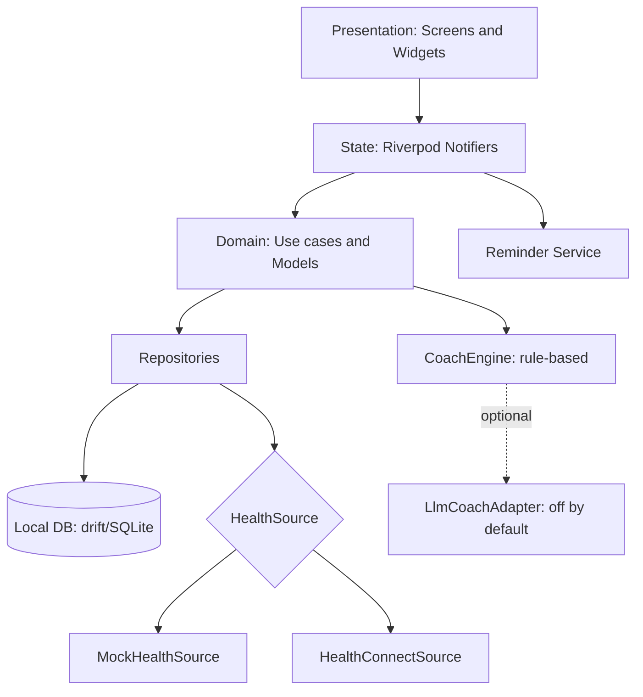

# CuraTrail Android Prototype: HLD, LLD and AI Build Prompts

**Goal:** a polished, native-feeling Android prototype of a CBT-inspired wellness app, shippable as an APK in a few hours, to pitch for an internship. **Assumptions:** Flutter (Dart), because their Android build is Flutter. Mock health data by default, with real Health Connect behind a toggle. No backend, all data on device. This is an independent concept prototype, not their code or brand assets. If you want Compose instead, the HLD stays the same and only the LLD/prompts change.

---

## 1. High-Level Design

### 1.1 Features (scope lock)

1. Onboarding (3 cards, permission rationale)
2. Daily check-in (mood, energy, stress in under 30 s)
3. Readiness dashboard (sleep, HRV, resting HR, readiness and stress score, 7/30-day trends)
4. CuraCoach: scripted, state-aware coaching that picks a CBT technique
5. Guided exercises (thought record, box breathing, 5-4-3-2-1 grounding, behavioral activation)
6. Progress (mood history and streak)
7. Crisis resources screen, reachable from every screen
8. Settings (data source toggle, delete all data, reminder time)

**Out of scope:** accounts, cloud sync, payments, real LLM calls, wearable pairing.

### 1.2 Architecture



**Pattern:** clean architecture, feature-first folders. UI never touches the DB or plugins directly. Everything external (health, LLM, clock) sits behind an interface so it can be mocked.

### 1.3 Tech stack

| Concern | Choice |
| --- | --- |
| UI | Flutter 3.x, Material 3, `dynamic_color` (Android 12+ wallpaper theming) |
| State | `flutter_riverpod` (plain Notifier/AsyncNotifier, no codegen) |
| Navigation | `go_router` with a bottom `NavigationBar` shell |
| Storage | `drift` + `sqlite3_flutter_libs`; `shared_preferences` for settings |
| Health | `health` package (Health Connect) behind `HealthSource` |
| Charts | `fl_chart` |
| Notifications | `flutter_local_notifications` (stretch goal) |
| Tests | `flutter_test`, `mocktail` |

### 1.4 Non-functional requirements

- **Privacy:** all data on device; no analytics SDKs; "Delete all data" works; Health Connect permissions requested only when the user turns on the toggle, with a rationale screen.
- **Safety:** every screen shows a persistent "Need help now?" entry; the app states it is wellness support, not treatment. Never present scores as diagnoses.
- **Performance:** cold start under 2 s; 60 fps animations; dashboard reads from a cached daily table.
- **Native feel:** dynamic color, light/dark, edge-to-edge, predictive back, haptics on key actions, 48dp touch targets, TalkBack labels, text scaling to 200%.

---

## 2. Low-Level Design

### 2.1 Folder structure

```
lib/
  main.dart, app.dart            # ProviderScope, MaterialApp.router, theme
  core/
    theme/ (app_theme.dart, tokens.dart)
    router/app_router.dart
    utils/ (clock.dart, date_utils.dart)
    widgets/ (crisis_fab.dart, score_ring.dart, app_card.dart)
  data/
    db/ (app_database.dart, tables.dart)
    health/ (health_source.dart, mock_health_source.dart, health_connect_source.dart)
    repositories/ (checkin_repo.dart, health_repo.dart, session_repo.dart, settings_repo.dart)
  domain/
    models/ (checkin.dart, health_day.dart, readiness.dart, technique.dart, coach_message.dart)
    usecases/ (compute_readiness.dart, pick_technique.dart, compute_streak.dart)
    coach/ (coach_engine.dart, coach_script.dart)
  features/
    onboarding/, checkin/, dashboard/, coach/, exercises/, progress/, crisis/, settings/
test/
```

### 2.2 Data models

```dart
class CheckIn { int id; DateTime ts; int mood; int energy; int stress; // each 1..5
                String? note; List<String> tags; }
class HealthDay { DateTime date; int? sleepMin; double? hrvMs; int? restingHr; int? steps; }
class Readiness { int score;        // 0..100, higher is better
                  int stressIndex;  // 0..100, higher is worse
                  ReadinessBand band; // low, moderate, good
                  List<String> drivers; } // e.g. "Sleep 1h below your baseline"
class Technique { String id; String title; TechniqueKind kind; int minutes;
                  List<Step> steps; List<Trigger> bestFor; }
class Step { String text; int? durationSec; StepType type; } // read, input, timer, breath
class ExerciseSession { int id; String techniqueId; DateTime startedAt, completedAt;
                        int? preMood, postMood; Map<String,String> inputs; }
```

### 2.3 Database schema (drift)

| Table | Columns |
| --- | --- |
| `checkins` | id PK, ts, mood, energy, stress, note?, tags (JSON text) |
| `health_days` | date PK (yyyy-MM-dd), sleep_min?, hrv_ms?, resting_hr?, steps?, source |
| `sessions` | id PK, technique_id, started_at, completed_at, pre_mood?, post_mood?, inputs (JSON) |

Indexes: `checkins(ts)`, `sessions(started_at)`. Settings in `shared_preferences`: `use_real_health`, `reminder_time`, `onboarded`.

### 2.4 Core algorithms

**Baseline:** the 14-day rolling mean of each metric, excluding today. If fewer than 5 days of data, use population defaults (sleep 450 min, HRV 50 ms, resting HR 62).

**Readiness (0..100):**

```
sleepScore = clamp(100 * sleepMin / 480)
hrvScore   = clamp(50 + 50 * (hrv - baseHrv) / (0.3 * baseHrv))
rhrScore   = clamp(50 - 50 * (rhr - baseRhr) / (0.15 * baseRhr))
readiness  = 0.40*sleepScore + 0.35*hrvScore + 0.25*rhrScore
```

Missing metric: drop it and renormalise the weights. **Stress index:** `0.6*(100 - readiness) + 0.4*((selfStress-1)/4*100)`; if there is no check-in today, use readiness only. Drivers: the two metrics that deviate most from baseline, phrased in plain language.

**Technique picker (`pickTechnique`)** is a first-match rule list:

1. stress index ≥ 70 or a "panic/racing" tag: box breathing (2 min)
2. mood ≤ 2 and energy ≤ 2: behavioral activation (small step)
3. note or tags mention worry or "what if": thought record
4. sleep below baseline by 60 min or more: wind-down breathing and sleep hygiene tip
5. default: 5-4-3-2-1 grounding

**Coach state machine** (CuraCoach, scripted): `Listen` (reflect the check-in back in one sentence) → `Explore` (one question with 3 tappable chips) → `Suggest` (technique card with a "why this, why now" line) → `Close` (after the exercise: pre/post mood delta and a one-line takeaway). Message templates are keyed by state and tag so replies feel specific. `LlmCoachAdapter` implements the same `CoachEngine` interface and is disabled by default; no API key lives in the app.

**Streak:** consecutive local days with at least one check-in, with a one-day grace. **Mock data:** a seeded generator creates 30 days with a plausible weekly rhythm and one rough patch, so charts look real.

### 2.5 Screen specs

| Screen | Key components | Behavior |
| --- | --- | --- |
| Onboarding | PageView with 3 cards, progress dots | Last card offers "Use sample data" or "Connect Health Connect" |
| Home/Today | Greeting, `ScoreRing` (readiness), stress chip, "Check in" CTA, today's suggested technique card, crisis entry | Pull to refresh; skeleton loaders |
| Check-in | 3 sliders or emoji scales, tag chips, optional note, haptic ticks | Save then navigate to Coach with the result |
| Coach | Chat-style bubbles (scripted), quick-reply chips, technique card | Typing indicator delay of 400–700 ms |
| Exercise runner | Step pager, breathing circle animation, timer, text inputs for the thought record, pre/post mood sheet | Prevent accidental exit (confirm dialog); save the session |
| Insights | Segmented 7/30 days, line chart (readiness vs mood), sleep and HRV bars, streak badge, top drivers | Reads `health_days` and `checkins` |
| Library | List of techniques with duration and "best for" chips | Opens the runner |
| Crisis | Calm layout: "If you're in immediate danger call your local emergency number", US 988 call and text, a "find a helpline" link, grounding shortcut | One tap to dial |
| Settings | Data source toggle, reminder time, export JSON, delete all, disclaimer | Delete requires confirmation |

### 2.6 Android specifics

- `AndroidManifest`: Health Connect read permissions for `SLEEP`, `HEART_RATE_VARIABILITY_RMSSD`, `RESTING_HEART_RATE`, `STEPS`; add the `<queries>` entry for the Health Connect package; add the permission-rationale activity-alias that Health Connect requires.
- `minSdk` 26, `targetSdk` current stable, `MainActivity` extends `FlutterFragmentActivity` (needed by the `health` plugin).
- Adaptive launcher icon with a themed monochrome layer; splash via the Android 12 splash API.
- Release: `flutter build apk --release --split-per-abi`, plus a debug-signed fallback if you have no keystore.

### 2.7 Test plan (minimal, high value)

Unit tests for `computeReadiness` (missing metrics, short baseline), `pickTechnique` (each rule), and `computeStreak` (grace day, timezone midnight). One widget test for the check-in flow. Manual run on a real device with Health Connect installed.

---

## 3. Timeline (about 5–6 hours)

| Block | Time | Output |
| --- | --- | --- |
| Scaffold, theme, router, DB | 45 min | App boots with navigation and dynamic color |
| Mock health and domain logic | 45 min | Readiness and picker with passing tests |
| Home, check-in, coach | 90 min | Core loop works end to end |
| Exercises and breathing animation | 60 min | Two exercises fully polished, the rest data-driven |
| Insights and progress | 45 min | Charts on seeded data |
| Crisis, settings, Health Connect | 45 min | Toggle works on device |
| Polish, icon, README, video, APK | 60 min | Demo ready |

**If you run short:** cut Library and the reminders, keep the loop of check-in, coach, exercise and dashboard.

---

## 4. Prompts to build it with AI

Use one chat or coding-agent session. Run the prompts in order, and run the app (`flutter run`) and fix errors before moving on. Paste the previous step's compile errors back verbatim.

### Prompt 0: Project rules (save as `CLAUDE.md` or paste first)

```
You are building "CuraTrail Android prototype", a Flutter (Dart 3, Material 3) wellness app.
Rules:
- Clean architecture, feature-first folders exactly as in the design doc I will paste.
- State: flutter_riverpod (Notifier/AsyncNotifier, no code generation). Navigation: go_router.
- Storage: drift (SQLite) + shared_preferences. All data stays on device. No analytics, no network calls.
- Every external dependency (health data, clock, LLM) is behind an interface.
- Use Material 3 with dynamic_color, light and dark themes, edge-to-edge, 48dp targets, semantics labels.
- Never present scores as medical diagnoses. Every screen must have a path to the crisis screen.
- Write small files, no giant widgets (>150 lines). Add unit tests only for domain logic.
- After each task: list files changed and commands I must run. Do not invent package APIs; if unsure, check the package docs.
Reply "ready" and wait for the design doc.
```

### Prompt 1: Scaffold

```
[Paste sections 1 and 2.1-2.3 of the design doc.]
Task: create the Flutter project skeleton. Add dependencies (flutter_riverpod, go_router, drift,
sqlite3_flutter_libs, path_provider, path, drift_dev and build_runner as dev deps, shared_preferences,
dynamic_color, fl_chart, health, mocktail). Create the folder structure with placeholder files,
app.dart with ProviderScope and MaterialApp.router, a Material 3 theme built from dynamic_color
with a calm teal fallback seed, go_router with a 4-tab NavigationBar shell (Today, Insights, Library, Settings),
and the drift database with the three tables. Give me the build_runner command. The app must compile and show 4 empty tabs.
```

### Prompt 2: Domain and real health data

```
Implement domain models and usecases (compute_readiness, pick_technique, compute_streak) per the design doc.
Do NOT create any mock data generator in lib/. Implement HealthSource with HealthConnectSource only
(package: health). Request read permission for sleep, HRV (RMSSD), resting heart rate and steps only when
the user taps "Connect". Handle: Health Connect not installed (link to Play page), permission denied (non-blocking
state), data missing (null metrics, never zeros), and the ~30-day history limit (expose baselineDays available).
HealthRepository aggregates raw records into one HealthDay per local date, caches to drift, and re-syncs on app resume.
Put a FakeHealthSource in test/ only. Write unit tests for compute_readiness with missing metrics and short baselines.
```

### Prompt 3: Check-in and repositories

```
Implement CheckInRepository, SessionRepository, SettingsRepository (drift DAOs + providers).
Build the Check-in screen per section 2.5: three 1-5 scales with haptic ticks, tag chips
(racing thoughts, tired, worried, calm, lonely, overwhelmed), optional note, Save button.
Saving writes to the DB and navigates to /coach with the new check-in id. Include loading and error states.
```

### Prompt 4: Home / Today

```
Build the Today screen: greeting by time of day, animated ScoreRing (readiness 0-100) in core/widgets,
stress chip (Low/Moderate/High with text, not color alone), a "Why" line from Readiness.drivers,
"Check in" primary CTA, today's suggested technique card from pickTechnique,
and a persistent "Need help now?" entry (core/widgets/crisis_fab.dart) usable on every screen.
Skeleton loaders while data loads. Support pull to refresh.
```

### Prompt 5.a: proxy server

```
Create /server: a Node.js (Express, TypeScript) proxy with POST /coach that accepts
{installId, context:{readinessBand, drivers[], mood, energy, stress, tags[], recentSummaries[]}, userMessage}.
Behavior: validate with zod; per-installId and per-IP rate limit; daily global cap; call the LLM API with the key from
an environment variable (never logged); stream the response as SSE; enforce JSON output
{reply, technique_id, chips[]} and retry once on invalid JSON; reject payloads over 4KB; no persistence of user text.
Include .env.example, a Dockerfile, and a deploy guide for a free tier (Render or Fly.io). Add a /health endpoint.
```

### Prompt 5.b: FlutterLLM coach
```
Implement LlmCoachEngine behind the existing CoachEngine interface. Before any network call, run
CrisisDetector (keyword and phrase list for self-harm, suicide, and immediate danger, case-insensitive) on user text:
if it triggers, skip the LLM and navigate to the crisis screen. Otherwise call the proxy via SSE (dio or http),
build the context from derived summaries only (never raw samples), validate technique_id against the catalog,
and fall back to ScriptedCoachEngine on timeout (8s), network error, or invalid output. Add a one-time consent
screen before the first LLM call and a settings toggle to turn AI coaching off. Show a subtle "AI-generated,
not medical advice" label in the coach screen.
```

### Prompt 6: Exercises

```
Create the data-driven technique catalog (domain/models/technique + features/exercises/catalog.dart) with:
box breathing, 5-4-3-2-1 grounding, thought record (situation, automatic thought, evidence for/against,
balanced thought), behavioral activation (pick one tiny action, schedule it), wind-down breathing.
Build the Exercise runner: step pager, animated breathing circle (inhale/hold/exhale driven by step durations),
countdown timer, text inputs for the thought record, a pre/post mood bottom sheet, exit-confirmation dialog,
haptics at phase changes. Save an ExerciseSession on completion. Polish box breathing and the thought record first.
```

### Prompt 7: Insights

```
Build the Insights screen: segmented 7/30 days, fl_chart line chart (readiness vs mood),
bar charts for sleep and HRV with a baseline line, streak badge, and "top drivers this week".
Handle empty and sparse data gracefully. Add semantics descriptions to charts.
```

### Prompt 8: Crisis, settings, onboarding

```
Build: Crisis screen per section 2.5 (calm layout; tel: and sms: intents for 988; "find a helpline" link;
grounding shortcut), Settings (use real health data toggle, reminder time, export JSON, delete all data with
confirmation), Onboarding (3 cards + permission rationale; "Use sample data" default).
Add a clear disclaimer: wellness support, not medical treatment.
```

### Prompt 9: Health Connect

```
Give me every AndroidManifest change for Health Connect (read permissions, <queries>, rationale activity-alias),
the MainActivity change (FlutterFragmentActivity), and minSdk. Then give me a step-by-step test plan using
Health Connect Toolbox to inject sleep, HRV, resting HR and steps for the last 14 days, and what each dashboard
state should look like when a metric is missing.
```

### Prompt 10: Polish and release

```
Do a polish pass: consistent spacing tokens, empty/error states on every screen, TalkBack labels,
200% text scale check, dark mode check, predictive back enabled, adaptive icon with monochrome layer, Android 12 splash.
Then write README.md (what it is, screenshots section, architecture diagram from the doc, how to run, privacy notes,
what is mocked, what I would build next). Give me the exact release build command and a 90-second demo script.
```

### Prompt 11: Bug-fix loop (reuse as needed)

```
Here is the error/stack trace and the file(s) involved: [paste]. Find the root cause, change the minimum code,
and explain in two lines why it broke. Don't refactor unrelated code.
```

---

## 5. Demo checklist (what the founder should see in 90 seconds)

1. Open, dynamic color adapts to the wallpaper (switch wallpaper on screen if you can).
2. Today screen: readiness ring and a plain-language "why".
3. 20-second check-in, coach reply, suggested exercise, 60 seconds of breathing, pre/post mood.
4. Insights charts, then the crisis screen in two taps.
5. Close on a README line: "Built to slot into your Flutter Android build; Health Connect ready; all data on device."


Health Connect — We'll build it fully. For emulator support: Android emulators on API 28+ can run Health Connect by sideloading its APK + using Health Connect Toolbox to inject synthetic data. I'll include full setup instructions.

LLM Coach (separate project) — The Flutter app's LlmCoachEngine will need exactly two endpoints from your proxy:

Endpoint	Method	Purpose
POST /coach	POST	Main coach turn — streams SSE response
GET /health	GET	Liveness check
POST /coach contract:

json
// Request body (max 4KB)
{
  "installId": "string (anonymous device ID)",
  "context": {
    "readinessBand": "low | moderate | good",
    "drivers": ["string"],
    "mood": 1-5,
    "energy": 1-5,
    "stress": 1-5,
    "tags": ["string"],
    "recentSummaries": ["string (last 3 session summaries, derived only)"]
  },
  "userMessage": "string"
}

// SSE stream response chunks → final JSON frame:
{ "reply": "string", "technique_id": "box_breathing | grounding_54321 | ...", "chips": ["string", "string", "string"] }
The Flutter LlmCoachEngine will call this via http SSE, validate technique_id against the catalog, and fall back to ScriptedCoachEngine on timeout (8s), network error, or invalid JSON. I'll build the Flutter side with the interface already stubbed for your proxy URL (read from a config constant).

Now let me start Task 1: Scaffold immediately.